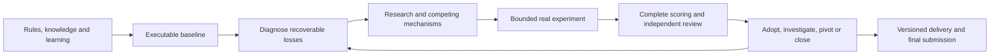

# Kaggle Research Lab

**A result-driven research skill for Kaggle: learn the domain, build a credible baseline, explore competing mechanisms, and close the loop with real results.**

[](https://github.com/haoran3160-afk/kaggle-research-lab/actions/workflows/checks.yml)
[](https://github.com/haoran3160-afk/kaggle-research-lab/releases)
[](LICENSE)
[](scripts/workspace.py)

[中文](README.zh-CN.md) · [Skill instructions](SKILL.md) · [System research](references/system-research.md) · [Package contents](docs/PACKAGE_CONTENTS.md)

## What it does

Kaggle Research Lab helps a coding agent run a competition as a research project. It connects public implementations and research papers to bounded experiments, independent review, and decisions about the current best solution.

- **Learn while competing.** Build a prerequisite map, inspect actual learning resources, and connect chapters to practical exercises. Research continues while user exercises are pending.
- **Establish credible baselines.** Separate a valid submission, a reproduced strong reference, and evidence of competitiveness. Adapt evaluation to prediction, static reasoning, or interactive agents.
- **Develop your own improvements.** Diagnose losses across data, representations, models, tools, memory, agent loops, harnesses, verification, and selection. Choose useful dimensions instead of running a universal checklist.
- **Use independent expertise.** Generate competing explanations before choosing experiments; challenge important implementations and interpretations using original artifacts and concrete counterexamples.
- **Finish the feedback loop.** Collect outputs, score them through the real consumer, retain failures and full costs, then adopt, investigate, pivot, or close the route.
- **Continue useful work.** While cloud results are pending, advance an independent mechanism or usable alternative. Resume accepted jobs by their IDs, preserve user schedules, and update continuation instructions as stages change.

## Install

Requires Python 3.11+ and an agent host capable of reading skills and using project tools. Kaggle and GitHub actions use your existing authenticated tools and competition-specific authorization.

```bash
git clone https://github.com/haoran3160-afk/kaggle-research-lab.git
cd kaggle-research-lab
python scripts/install_skill.py
```

The default destination is `~/.agents/skills/kaggle-research-lab`. For another host:

```bash
python scripts/install_skill.py --destination /your/skills/kaggle-research-lab
```

The installer includes all nine modules, active references, templates, and bundled upstream skills with their licenses. Existing installations are backed up outside the skill discovery directory. It creates no checksum manifests.

## Use

Ask your skill-capable agent:

```text
Use $kaggle-research-lab to start this competition: <competition URL>.
Read the rules and existing project, identify the most valuable unknown,
establish a real baseline, and run the next useful bounded experiment.
Use free resources and keep my scheduling settings unchanged.
```

For an existing project:

```text
Use $kaggle-research-lab to continue this competition from <state path>.
Collect accepted jobs first, compare complete results with the champion,
and investigate the largest recoverable loss before choosing the next experiment.
```

The host performs research, runs tools, and makes evidence-based decisions. **The Python helpers are a work record (`workspace.py`) and a resolution calculator for scores and paired evaluations (`resolution.py`); neither is an autonomous model runner or scheduler.** Recurring execution requires the host's automation capability and an available machine. Installing this skill does not grant account actions or create an automation.

## The research loop



| Module | Main output |
|---|---|
| [Project specifications](modules/specs.md) | Adaptable AGENTS/SPEC and one current state entry |
| [Learning](modules/learning.md) | Relevant resources, prerequisites and user practice |
| [Open-solution discovery](modules/intelligence.md) | Verified mechanisms that can enter an experiment |
| [Baselines](modules/baseline.md) | Executable comparison and task-appropriate evaluation |
| [Research](modules/research.md) | Competing hypotheses and the next discriminating experiment |
| [Improvement feedback](modules/progress.md) | Net benefit, regressions, adoption or a justified pivot |
| [Execution](modules/execution.md) | Real outputs, recoverable remote IDs and the next action |
| [GitHub delivery](modules/delivery.md) | Reviewable, recoverable project versions |
| [Closeout](modules/closeout.md) | Final selection, actual results and transferable lessons |

## Measure outcomes, not activity

The [seven effectiveness questions](references/effectiveness.md) assess result gains, decision value, discovery-to-experiment transfer, expert diversity, review corrections, unattended completion, and human learning.

Real quality gains, equal-quality cost savings, mechanism evidence, and official diagnostics are reported separately. Repeated failures, missing results, validation exposure, and additional repair opportunities stay visible. A tool call, passing test suite, published PR, or author's leaderboard score does not establish that our candidate is better.

**This skill has not established a general score or medal improvement guarantee.** Its design draws on competition failures and live coding-agent experiments, including unsuccessful optimization attempts. See [transferable lessons and evidence limits](docs/LESSONS.md).

## Bundled expertise

Seven selected skills from [OpenAI Skills](https://github.com/openai/skills), [Superpowers](https://github.com/obra/superpowers), and [K-Dense Scientific Agent Skills](https://github.com/K-Dense-AI/scientific-agent-skills) are included with narrow [adapters](references/adapters.md). They support research, debugging, review, and GitHub delivery. Their upstream instructions and licenses are preserved; popularity is not treated as evidence of competition performance.

See [third-party notices](THIRD_PARTY_NOTICES.md) and [source attribution](upstream/SOURCES.md).

## Development

```bash
python -m unittest discover -s tests -v
```

Tests verify the work-record, resolution-calculator and installation behavior. They do not measure competition performance. Contributions should identify a real failure or research opportunity, make a small useful change, and report observed outcomes and limitations. See [CONTRIBUTING](CONTRIBUTING.md) and [CHANGELOG](CHANGELOG.md).

## License

Original workflow content and helpers are [MIT licensed](LICENSE). Bundled upstream materials retain their own MIT or Apache-2.0 licenses. Competition assets, private run histories, credentials, model weights, and official judging materials are not distributed.
